# Hướng dẫn Thiết lập CI/CD với GitHub Actions và VPS (Nexus Portal)

Tài liệu này hướng dẫn chi tiết từng bước để cấu hình tự động kiểm thử (CI) và triển khai (CD) mã nguồn lên máy chủ VPS qua SSH khi push code lên GitHub.

---

## 1. Tổng quan Kiến trúc Pipeline

```mermaid
flowchart TD
    Dev["Developer"] -->|"git push origin main"| GitHub["GitHub Repository"]
    
    subgraph GitHub_Actions["GitHub Actions Workflow (.github/workflows/deploy.yml)"]
        direction TB
        subgraph CI["1. Giai đoạn CI (Chạy song song)"]
            BE_CI["Backend CI\n- Setup Java 17\n- Maven clean test"]
            FE_CI["Frontend CI\n- Setup Node 20\n- npm ci && npm run build"]
        end
        
        subgraph CD["2. Giai đoạn CD (Deploy qua SSH)"]
            SSH["appleboy/ssh-action\nKết nối VPS bằng SSH Key"]
        end
        
        BE_CI --> CD
        FE_CI --> CD
    end

    GitHub --> GitHub_Actions
    CD -->|"SSH"| VPS["Máy chủ VPS"]
    
    subgraph VPS_Docker["Docker Compose trên VPS (docker-compose.prod.yml)"]
        direction TB
        GitPull["git reset --hard origin/main"]
        DeployScript["Chạy scripts/deploy.sh"]
        MySQL["Container nexus_mysql_db (Port 3306)"]
        BE["Container nexus_backend_api (Port 8080)"]
        FE["Container nexus_frontend_app (Nginx Port 80 / Reverse Proxy /api)"]
        
        GitPull --> DeployScript
        DeployScript --> MySQL
        DeployScript --> BE
        DeployScript --> FE
    end

    VPS --> VPS_Docker
```



---

## 2. Chuẩn bị trên máy chủ VPS (Thực hiện 1 lần đầu)

### Bước 2.1: Cài đặt Docker & Docker Compose trên VPS
Nếu VPS của bạn (Ubuntu/Debian) chưa có Docker, hãy chạy:
```bash
# Cập nhật package & cài Docker
curl -fsSL https://get.docker.com | sh

# Cho phép user không cần sudo khi chạy Docker (thay 'ubuntu' bằng user của bạn)
sudo usermod -aG docker $USER
newgrp docker

# Kiểm tra phiên bản
docker --version
docker compose version
```

### Bước 2.2: Tạo thư mục & Clone Repository về VPS lần đầu
Đăng nhập vào VPS và clone dự án về:
```bash
# Chuyển về thư mục home
cd ~

# Clone dự án (chứa project-nexus-portal)
git clone https://github.com/luonghoangphat2001/project-nexus-portal.git

# Di chuyển vào thư mục project-nexus-portal
cd project-nexus-portal/project-nexus-portal
ls -la
```

> [!TIP]
> Nếu repository là Private, bạn có thể tạo một **Deploy Key** trên GitHub (Read-only) rồi thêm vào `~/.ssh/id_rsa` trên VPS, hoặc dùng **GitHub Personal Access Token** để git clone / pull không bị hỏi mật khẩu.

### Bước 2.3: Tạo và cấu hình file `.env` trên VPS
Tạo file cấu hình môi trường thực tế trên VPS để Docker sử dụng:
```bash
cd ~/project-nexus-portal/project-nexus-portal

# Copy từ mẫu
cp be/.env.example be/.env
cp fe/.env.example fe/.env
```

Chỉnh sửa file `be/.env` với mật khẩu production an toàn:
```bash
nano be/.env
```
Các thông số cần lưu ý:
- `DB_PASSWORD`: Đổi thành mật khẩu DB bảo mật trên VPS.
- `JWT_SECRET`: Chuỗi khóa ký JWT ngẫu nhiên (tối thiểu 64 ký tự hex).
- `CORS_ALLOWED_ORIGIN`: Địa chỉ IP VPS hoặc tên miền của bạn (ví dụ: `http://<IP_VPS>,http://<IP_VPS>:80`).
- `SQL_INIT_MODE`: Để `always` cho lần đầu khởi tạo dữ liệu, sau đó có thể đổi thành `never` để giữ nguyên DB đã chạy.

Chỉnh sửa file `fe/.env`:
```bash
nano fe/.env
```
- `VITE_API_BASE_URL=http://<IP_VPS>:8080/api`: URL trỏ trực tiếp đến Backend API trên VPS.
- `PORT=3000`: Cổng frontend.

---

## 3. Thiết lập GitHub Secrets

Pipeline sử dụng SSH Password trực tiếp qua secret `VPS_PASSWORD`.

1. Truy cập: `https://github.com/luonghoangphat2001/project-nexus-portal`
2. Chọn **Settings** -> **Secrets and variables** -> **Actions** -> **New repository secret**.
3. Thêm các secret sau:

| Tên Secret | Ý nghĩa | Ví dụ |
| :--- | :--- | :--- |
| `VPS_HOST` | Địa chỉ IP của VPS | `103.176.178.99` |
| `VPS_USERNAME` | Tên đăng nhập SSH | `root` hoặc `ubuntu` |
| `VPS_PASSWORD` | Mật khẩu đăng nhập SSH | `mat_khau_vps_cua_ban` |
| `VPS_TARGET_DIR` | Thư mục repo trên VPS | `/home/ubuntu/project-nexus-portal` |
| `VPS_SSH_PORT` | Cổng SSH *(tùy chọn, mặc định 22)* | `22` |

---

## 4. Cách thức Vận hành và Kiểm tra

### 4.1 Kích hoạt Pipeline tự động
Mỗi khi bạn commit và push code lên nhánh `main`:
```bash
git add .
git commit -m "feat: cập nhật tính năng mới"
git push origin main
```
Pipeline sẽ tự động kích hoạt:
1. **Backend CI**: Biên dịch và chạy bộ test của Spring Boot.
2. **Frontend CI**: Cài đặt thư viện và build bundle React.
3. **CD Deploy**: Kết nối vào VPS qua SSH, tự động chạy `scripts/deploy.sh` để cập nhật container Docker.

### 4.2 Kích hoạt thủ công qua GitHub Actions (Manual Trigger)
1. Vào tab **Actions** trên GitHub.
2. Chọn workflow **CI/CD Pipeline - Nexus Portal** ở cột bên trái.
3. Bấm nút **Run workflow** -> chọn nhánh `main` -> bấm nút xanh **Run workflow**.

### 4.3 Kiểm tra dịch vụ sau khi deploy
Trên trình duyệt hoặc terminal:
- **Giao diện Web Frontend**: `http://<IP_VPS>:80` (hoặc `http://<IP_VPS>`)
- **Backend API**: `http://<IP_VPS>:8080/api`
- **Swagger Documentation**: `http://<IP_VPS>:8080/swagger-ui.html`

Trên VPS, kiểm tra logs bằng Docker:
```bash
cd ~/laptrinhweb_ute/project-nexus-portal

# Xem trạng thái các container
docker compose -f docker-compose.prod.yml ps

# Xem log Backend
docker compose -f docker-compose.prod.yml logs -f backend_api

# Xem log Frontend
docker compose -f docker-compose.prod.yml logs -f frontend_app
```

---

## 5. Xử lý sự cố thường gặp (Troubleshooting)

1. **Lỗi `Host key verification failed` hoặc `Connection refused`**:
   - Kiểm tra xem firewall VPS (UFW hoặc security group của nhà cung cấp Cloud) đã mở cổng 22 chưa.
   - Kiểm tra `VPS_HOST` đã đúng IP chưa.
2. **Lỗi `Permission denied (publickey)`**:
   - Kiểm tra lại xem Public Key đã được thêm vào `~/.ssh/authorized_keys` của đúng user (`VPS_USERNAME`) chưa.
   - Kiểm tra phân quyền: `chmod 700 ~/.ssh` và `chmod 600 ~/.ssh/authorized_keys`.
3. **Lỗi `npm ci` trong Frontend CI**:
   - Chạy `npm install` ở máy local rồi commit file `package-lock.json` nếu có thay đổi dependency mới.
4. **Lỗi Backend không kết nối được MySQL trên VPS**:
   - MySQL cần khoảng 15-20 giây để khởi động trong lần đầu tiên. Container `backend_api` đã được cấu hình chờ `mysql_db` chuyển sang trạng thái `healthy` trước khi khởi động.

